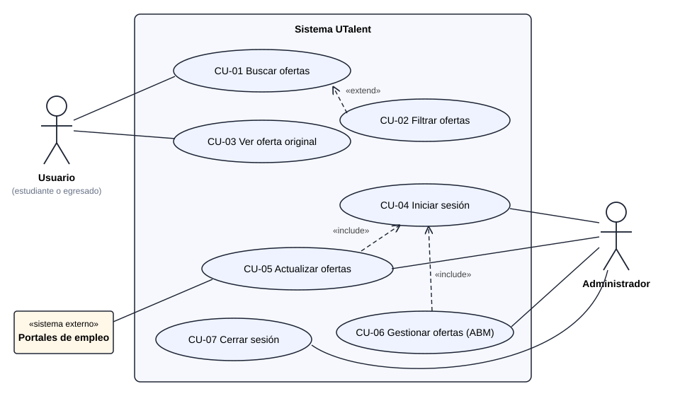
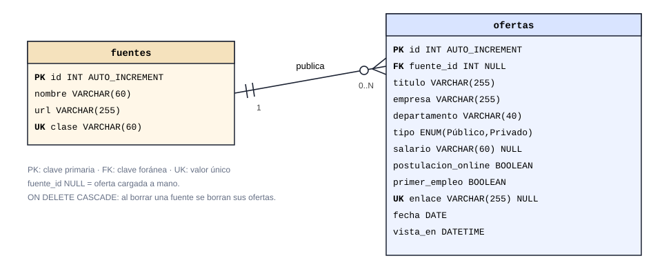
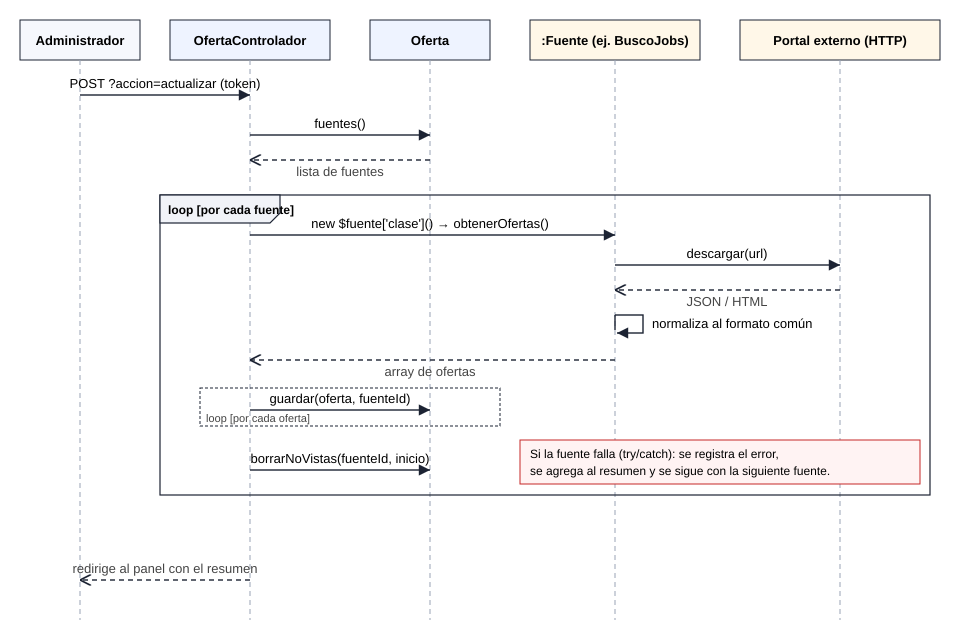
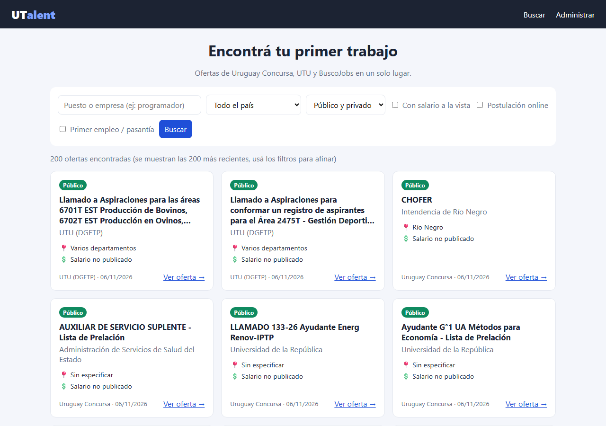

# UTalent — Documento de Ingeniería de Software

**Cuarto Práctico · Programación Full-Stack · 3.° BT Tecnologías de la Información**
Escuela Técnica Rocha · 2026 · Lucas Techera

## Control del documento

| Versión | Fecha | Descripción |
|---|---|---|
| 1.0 | 01/10/2026 | Primera versión: arquitectura, tecnología y diagrama de clases del MVP. |
| 2.0 | 07/11/2026 | Documento completo: ERS, casos de uso, diseño, pruebas, riesgos, implantación y mantenimiento. |

| Dato | Valor |
|---|---|
| Proyecto | UTalent — Buscador de ofertas de empleo para estudiantes de UTU |
| Propuesta de la letra | Opción 3 — Buscador de oportunidades de trabajo |
| Autor | Lucas Techera |
| Repositorio | github.com/lrtd2021-oss/UTalent |

## 1. Introducción

### 1.1 Propósito del documento

Este documento describe el ciclo de vida completo de UTalent, desde la especificación de
requerimientos hasta la entrega. Sigue la estructura de la norma IEEE 830 para la
Especificación de Requerimientos de Software (ERS) y la complementa con el diseño, las
pruebas, la gestión de riesgos, la implantación y el mantenimiento del sistema.

Está dirigido al docente de Programación Full-Stack, que lo evalúa, y a quien tenga que
instalar, usar o modificar el sistema.

### 1.2 Alcance del producto

Los estudiantes y egresados de UTU que buscan empleo tienen que recorrer por separado
varios portales, cada uno con su formato y sus filtros. **UTalent** reúne en un solo lugar las
ofertas de tres fuentes uruguayas (Uruguay Concursa, la web de UTU y BuscoJobs), las
normaliza a un formato común y permite filtrarlas con criterios útiles para quien busca su
primer trabajo.

El sistema **sí hace**:
- Obtener ofertas de las fuentes y guardarlas en una base de datos local.
- Buscar y filtrar ofertas por texto, departamento, tipo de empleador, salario visible,
  postulación online y primer empleo.
- Enlazar cada oferta con el aviso original.
- Permitir que un administrador actualice las ofertas y las dé de alta, modifique o elimine.

El sistema **no hace** (fuera de alcance, según la letra):
- Registro de usuarios ni perfiles personales.
- Postulación a ofertas desde el sistema: el usuario se postula en el portal original.

### 1.3 Definiciones y acrónimos

| Término | Significado |
|---|---|
| ERS | Especificación de Requerimientos de Software. |
| RF / RNF | Requerimiento funcional / requerimiento no funcional. |
| CU / CP | Caso de uso / caso de prueba. |
| MVP | Producto mínimo viable: la versión más simple que cumple el objetivo y se puede usar. |
| MVC | Modelo–Vista–Controlador, patrón de arquitectura usado en el sistema. |
| ABM | Alta, baja y modificación de datos (en inglés, CRUD). |
| Fuente | Portal externo del que se obtienen ofertas. |
| API | Interfaz que un sistema ofrece para que otros programas le pidan datos. |
| JSON | Formato de texto estructurado para intercambiar datos. |
| PDO | Extensión de PHP para conectarse a bases de datos con consultas preparadas. |
| CSRF / XSS | Tipos de ataque web: envío de formularios desde otro sitio / inyección de código en la página. |
| DGETP | Dirección General de Educación Técnico Profesional (UTU). |

### 1.4 Visión general del documento

- **Sección 2:** requerimientos del sistema (ERS).
- **Sección 3:** casos de uso.
- **Sección 4:** proceso de desarrollo seguido.
- **Sección 5:** análisis y diseño (arquitectura, clases, datos y secuencia).
- **Sección 6:** implementación.
- **Sección 7:** pruebas.
- **Sección 8:** gestión de riesgos.
- **Sección 9:** implantación y entrega.
- **Sección 10:** mantenimiento.
- **Sección 11:** uso de inteligencia artificial.
- **Sección 12:** conclusiones.
- **Anexo A:** relaciona cada ejercicio de la letra con la sección que lo responde.

## 2. Especificación de Requerimientos de Software (ERS)

### 2.1 Perspectiva del producto

UTalent es un sistema web independiente que funciona en un servidor local (XAMPP). Se
conecta a tres sistemas externos para obtener ofertas y guarda una copia normalizada en su
propia base de datos. Los usuarios consultan siempre esa base local, nunca los portales
directamente.

### 2.2 Interesados y usuarios

| Interesado | Rol | Interés principal |
|---|---|---|
| Estudiantes y egresados de UTU | Usuario final | Encontrar ofertas acordes a su perfil sin recorrer varios portales. |
| Administrador (docente o adscripto) | Usuario con permisos | Mantener las ofertas actualizadas y cargar oportunidades locales. |
| Docente de Programación Full-Stack | Cliente y evaluador | Que el sistema cumpla la letra y que el código sea entendible y defendible. |
| Desarrollador (estudiante) | Equipo de desarrollo | Construir un MVP simple, mantenible y que pueda explicar. |

### 2.3 Requerimientos funcionales

Prioridad según el método **MoSCoW**: *Debe* (imprescindible), *Debería* (importante) y
*Podría* (deseable).

| ID | Requerimiento | Prioridad |
|---|---|---|
| RF-01 | El sistema debe permitir buscar ofertas por texto en el título o en la empresa. | Debe |
| RF-02 | El sistema debe permitir filtrar por departamento (los 19 departamentos y "Varios departamentos"). | Debe |
| RF-03 | El sistema debe permitir filtrar por tipo de empleador: público o privado. | Debe |
| RF-04 | El sistema debe permitir filtrar las ofertas que muestran el salario. | Debe |
| RF-05 | El sistema debe permitir filtrar las ofertas con postulación online. | Debe |
| RF-06 | El sistema debería permitir filtrar ofertas de primer empleo o pasantía. | Debería |
| RF-07 | El sistema debe mostrar cada oferta con el mismo formato: título, empresa, departamento, tipo, salario, fuente y fecha. | Debe |
| RF-08 | El sistema debe enlazar cada oferta con el aviso original en el portal de origen. | Debe |
| RF-09 | El sistema debe obtener ofertas de Uruguay Concursa, de la web de UTU y de BuscoJobs. | Debe |
| RF-10 | El sistema debe convertir las ofertas de cada fuente a un formato común. | Debe |
| RF-11 | El sistema debe evitar guardar dos veces la misma oferta. | Debe |
| RF-12 | El sistema debe eliminar las ofertas que ya no aparecen en su fuente (cerradas). | Debería |
| RF-13 | El sistema debe restringir la administración a quien conozca la contraseña. | Debe |
| RF-14 | El administrador debe poder dar de alta ofertas manualmente. | Debe |
| RF-15 | El administrador debe poder modificar ofertas. | Debe |
| RF-16 | El administrador debe poder eliminar ofertas. | Debe |
| RF-17 | El sistema debería informar el resultado de cada actualización, fuente por fuente. | Debería |

### 2.4 Requerimientos no funcionales

| ID | Categoría | Requerimiento | Criterio de aceptación |
|---|---|---|---|
| RNF-01 | Usabilidad | La interfaz debe adaptarse a celular, tablet y computadora. | Se usa sin desplazamiento horizontal desde 375 px de ancho. |
| RNF-02 | Rendimiento | Las búsquedas deben responder rápido. | Menos de 1 segundo con la base cargada. Medido: unos 17 ms con 528 ofertas. |
| RNF-03 | Seguridad | El sistema debe resistir los ataques web más comunes (OWASP Top 10). | Sin inyección SQL, XSS ni CSRF en las pruebas de la sección 7. |
| RNF-04 | Mantenibilidad | Agregar una fuente no debe requerir cambiar el código existente. | Una clase nueva en `Servicios/` y una fila en la tabla `fuentes`. |
| RNF-05 | Tolerancia a fallos | La falla de una fuente no debe afectar a las demás. | Las otras fuentes se actualizan y el panel informa el error. |
| RNF-06 | Portabilidad | El sistema debe funcionar en XAMPP sin instalar dependencias. | Solo PHP 8.1 o superior (con cURL y PDO) y MySQL/MariaDB. |
| RNF-07 | Comprensibilidad | El código debe poder explicarse y modificarse en clase. | Archivos cortos, nombres en español y comentarios que explican el porqué. |
| RNF-08 | Ética y legalidad | El sistema debe respetar a los portales de origen. | No evade bloqueos, se identifica como UTalent y siempre enlaza al aviso original. |

### 2.5 Restricciones

- **Tecnología:** PHP y MySQL sin frameworks, ejecutado en XAMPP (decisión fundamentada en
  la sección 5.2).
- **Alcance definido por la letra:** sin registro de usuarios y sin postulación desde el
  sistema.
- **Fuentes externas:** solo se usan las que permiten el acceso automatizado. Las que lo
  bloquean se descartan (sección 5.6).
- **Plazo:** el del Cuarto Práctico (2026).

### 2.6 Supuestos y dependencias

- Las APIs de Uruguay Concursa y de UTU, y la estructura de la página de BuscoJobs,
  pueden cambiar sin aviso. Si cambian, hay que ajustar solo la clase de esa fuente.
- El servidor tiene acceso a Internet para actualizar las ofertas. Las búsquedas funcionan
  sin Internet sobre las ofertas ya guardadas.

## 3. Casos de uso

### 3.1 Diagrama de casos de uso

| Actor | Descripción |
|---|---|
| Usuario | Estudiante o egresado que busca ofertas. No necesita iniciar sesión. |
| Administrador | Mantiene las ofertas. Necesita la contraseña del panel. |
| Portales de empleo | Sistemas externos (Uruguay Concursa, UTU, BuscoJobs) que proveen las ofertas. |

### 3.2 Especificación de los casos de uso principales

**CU-01 Buscar ofertas** (extendido por CU-02 Filtrar ofertas)

| Campo | Descripción |
|---|---|
| Actor | Usuario |
| Precondición | Hay ofertas guardadas en la base de datos. |
| Flujo principal | 1. El usuario entra a la página principal. 2. Escribe un texto y/o elige filtros. 3. Presiona "Buscar". 4. El sistema muestra la cantidad de resultados y las tarjetas de las ofertas, de la más reciente a la más antigua. |
| Flujo alternativo | 4a. No hay coincidencias: el sistema muestra "0 ofertas encontradas". 4b. Hay más de 200: se muestran las 200 más recientes y se sugiere usar filtros. |
| Postcondición | Ninguna; la búsqueda no modifica datos. |
| Requerimientos | RF-01 a RF-08 |

**CU-04 Iniciar sesión**

| Campo | Descripción |
|---|---|
| Actor | Administrador |
| Flujo principal | 1. El administrador entra a "Administrar". 2. Ingresa la contraseña. 3. El sistema la verifica contra el hash guardado, regenera la sesión y muestra el panel. |
| Flujo alternativo | 3a. La contraseña es incorrecta: el sistema muestra "Contraseña incorrecta." y vuelve a pedirla. |
| Requerimientos | RF-13 |

**CU-05 Actualizar ofertas**

| Campo | Descripción |
|---|---|
| Actor | Administrador (y Portales de empleo como actor secundario) |
| Precondición | Sesión iniciada (incluye CU-04). |
| Flujo principal | 1. El administrador presiona "Actualizar ofertas". 2. Para cada fuente de la tabla `fuentes`, el sistema descarga sus ofertas, las normaliza y las guarda sin duplicarlas. 3. Borra las ofertas de esa fuente que ya no aparecen. 4. Muestra un resumen por fuente: ofertas traídas y ofertas cerradas. |
| Flujo alternativo | 2a. Una fuente no responde o cambió su formato: se registra el error, el resumen lo indica ("no respondió") y se continúa con la siguiente. 2b. Una fuente devuelve 0 ofertas: no se borra nada de esa fuente, porque puede estar caída. |
| Postcondición | La base contiene las ofertas vigentes de todas las fuentes que respondieron. |
| Requerimientos | RF-09 a RF-12, RF-17 |

**CU-06 Gestionar ofertas (ABM)**

| Campo | Descripción |
|---|---|
| Actor | Administrador |
| Precondición | Sesión iniciada (incluye CU-04). |
| Flujo principal | **Alta:** completa el formulario y presiona "Guardar". **Modificación:** presiona "Editar" en una fila, cambia los datos y guarda. **Baja:** presiona "Eliminar" y confirma. El sistema muestra un mensaje con el resultado. |
| Flujo alternativo | Datos inválidos (título vacío, enlace que no empieza con http/https, fecha incorrecta, etc.): se informa el error y no se guarda. Enlace repetido: "Ya existe otra oferta con ese enlace." |
| Requerimientos | RF-14 a RF-16 |

## 4. Proceso de desarrollo

### 4.1 Modelo de proceso

Se siguió un **modelo incremental e iterativo**. En cada iteración se entregó una versión
funcionando y se ajustaron los requerimientos según lo aprendido. Se eligió este modelo
porque:

- Las fuentes externas eran inciertas: no se sabía de antemano cuáles permitirían el
  acceso. Cada iteración validó fuentes reales antes de seguir.
- Permite tener un MVP usable pronto y mejorarlo después, en lugar de entregar todo al final.
- La primera iteración demostró que el diseño inicial era demasiado complejo, y el modelo
  iterativo permitió corregir el rumbo a tiempo.

### 4.2 Iteraciones

| Iteración | Fecha | Resultado |
|---|---|---|
| 0 — Prototipo en Laravel | 14 y 15/09/2026 | Primera versión con Laravel, colas, servicios y normalización con IA. Funcionaba, pero tenía demasiados archivos y capas para un MVP académico y era difícil de explicar. **Se descartó.** |
| 1 — MVP en PHP vanilla | 01/10/2026 | Reinicio desde cero. Análisis de la letra, investigación de fuentes (se encontraron las APIs de Uruguay Concursa y BuscoJobs), arquitectura MVC, base de datos, buscador, panel de administración y pruebas. |
| 2 — Ampliación y cierre | 07/11/2026 | Nueva fuente (UTU). Evaluación y descarte de Computrabajo y otros portales. Auditoría de código y diseño. Documentación completa y publicación en GitHub. |

### 4.3 Herramientas

| Herramienta | Uso |
|---|---|
| XAMPP (Apache, MariaDB, PHP 8.2) | Entorno de ejecución local. |
| Git y GitHub | Control de versiones y entrega. El historial muestra cada iteración. |
| Navegador web (Edge, Chrome) | Pruebas de interfaz y diseño adaptable. |
| curl | Pruebas de las fuentes externas y de las acciones del sistema. |
| Claude Code (IA) | Asistente de programación (ver sección 11). |

### 4.4 Gestión de la configuración

El código se versiona con Git en la rama `master`. Cada commit agrupa un cambio con
sentido propio (base de datos, modelo y fuentes, controlador y vistas, documentación). El
commit "Reinicio" marca el paso de la iteración 0 a la 1, y el historial de la versión en
Laravel se conservó para que se vea la evolución del trabajo.

## 5. Análisis y diseño

### 5.1 Arquitectura: patrón MVC

El sistema sigue el patrón **Modelo–Vista–Controlador (MVC)**:

| Capa | Archivo | Responsabilidad |
|---|---|---|
| Modelo | `modelos/Oferta.php` | Único lugar con SQL. Busca, agrega, modifica y elimina ofertas. |
| Vista | `vistas/*.php` | HTML que muestra los datos. No consulta la base ni toma decisiones. |
| Controlador | `controladores/OfertaControlador.php` | Recibe el pedido, valida los datos, llama al modelo y elige la vista. |

`index.php` es el único punto de entrada (*front controller*): lee el parámetro `?accion=` y
llama al método correspondiente del controlador.

**Por qué MVC:**
- **Separa responsabilidades.** Si cambia el diseño, se tocan solo las vistas y el CSS. Si
  cambia la base de datos, solo el modelo.
- **Es fácil de mantener y explicar.** Cada archivo tiene una única tarea, así que ante un
  error se sabe dónde buscar.
- **Es el patrón que se trabaja en el curso** y el que usan los frameworks más comunes
  (Laravel, Symfony), así que lo aprendido acá sirve después.

**Patrón complementario: Strategy (para las fuentes).** Cada portal se lee de forma distinta.
Para que el resto del sistema no tenga que saber esas diferencias, todas las fuentes heredan
de la clase abstracta `Fuente` y deben implementar el mismo método, `obtenerOfertas()`, que
devuelve las ofertas siempre con el mismo formato. Esto cumple el principio
**abierto/cerrado**: el sistema se amplía con una fuente nueva sin modificar el código que
ya existe (RNF-04).

No se agregaron más patrones (repositorios, servicios, fábricas, colas) porque para el
tamaño de este proyecto sumarían archivos sin aportar beneficios reales.

### 5.2 Tecnología: PHP y MySQL sin frameworks

Se eligió **PHP y MySQL sin frameworks** (vanilla), ejecutado en **XAMPP**, en lugar de Laravel.

| Criterio | PHP vanilla | Laravel |
|---|---|---|
| Archivos del proyecto | 14 archivos propios | Cientos de archivos antes de escribir código propio |
| Comprensión del código | Cada línea se escribió o se revisó para este proyecto | Gran parte del funcionamiento queda oculto en el framework |
| Instalación | Copiar la carpeta e importar un `.sql` | Composer, dependencias, archivo `.env`, migraciones |
| Necesidades del proyecto | Pocas rutas, dos tablas, un panel | Pensado para aplicaciones mucho más grandes |

La iteración 0 confirmó esta decisión en la práctica: la versión en Laravel funcionaba, pero
era mucho más difícil de entender y defender. La letra pide poder identificar y modificar el
código en clase (RNF-07), y con PHP vanilla todo lo que hace el sistema está a la vista en
archivos cortos y comentados.

Se usa **PDO** para la base de datos porque viene incluido en PHP y permite consultas
preparadas, que protegen contra la inyección SQL.

### 5.3 Diagrama de clases

- `OfertaControlador` **usa** un objeto `Oferta` (el modelo) para acceder a los datos.
- `OfertaControlador` **crea** las fuentes a partir de la tabla `fuentes` (columna `clase`).
- `UruguayConcursa`, `BuscoJobs` y `Utu` **heredan** de la clase abstracta `Fuente`.
  Heredan dos métodos de apoyo: `descargar()`, que hace pedidos HTTP con cURL, y
  `detectarDepartamento()`, que reconoce el departamento dentro de un texto libre.

### 5.4 Modelo de datos

**Diccionario de datos de la tabla `ofertas`:**

| Campo | Tipo | Descripción |
|---|---|---|
| `id` | INT, PK | Identificador de la oferta. |
| `fuente_id` | INT, FK, puede ser NULL | Fuente de origen. NULL = cargada a mano desde el panel. |
| `titulo` | VARCHAR(255) | Puesto ofrecido. |
| `empresa` | VARCHAR(255) | Empresa u organismo. |
| `departamento` | VARCHAR(40) | Uno de los 19 departamentos, "Varios departamentos" o "Sin especificar". |
| `tipo` | ENUM | "Público" o "Privado". |
| `salario` | VARCHAR(60), puede ser NULL | Monto publicado. NULL = el aviso no lo muestra. |
| `postulacion_online` | BOOLEAN | 1 si la postulación se hace por Internet. |
| `primer_empleo` | BOOLEAN | 1 si es para primer empleo o pasantía. |
| `enlace` | VARCHAR(255), UNIQUE | Dirección del aviso original. Al ser único, evita duplicados (RF-11). |
| `fecha` | DATE | Fecha de publicación. |
| `vista_en` | DATETIME | Última vez que la fuente trajo la oferta. Sirve para detectar las cerradas (RF-12). |

La tabla `fuentes` guarda `id`, `nombre`, `url` y `clase`. `clase` es el nombre de la clase
PHP que sabe leer esa fuente.

### 5.5 Diagrama de secuencia: actualizar ofertas

El caso de uso más complejo es CU-05. Este diagrama muestra cómo colaboran las clases:

### 5.6 Fuentes de datos

Antes de leer el HTML de cada portal, se buscó si ofrecía los datos en un formato
estructurado (API o JSON). Así el sistema es más simple y se rompe menos cuando cambia el
diseño de un sitio.

| Fuente | Tipo | Cómo se obtienen los datos |
|---|---|---|
| Uruguay Concursa | Público | API JSON que usa su propia web (`/api-backend/llamados/find`), pidiendo solo los llamados abiertos. |
| UTU (DGETP) | Público | API JSON estándar de WordPress (`/wp-json/wp/v2/posts`). Se filtran los anuncios que empiezan con "Llamado". |
| BuscoJobs | Privado | Cada página del listado trae las ofertas en un bloque JSON (`__NEXT_DATA__`). Se lee ese bloque y no el HTML. |

Fuentes evaluadas y descartadas:

| Fuente | Motivo |
|---|---|
| Computrabajo | Rechaza los pedidos automatizados (error 403). Saltar ese bloqueo haciéndose pasar por un navegador no sería correcto (RNF-08). |
| Gallito Trabajo, Indeed, Jooble | Rechazan los pedidos automatizados (error 403). |
| Vía Trabajo (MTSS) | Para ver las ofertas hay que iniciar sesión. |
| LinkedIn | Sus condiciones de uso prohíben la extracción automatizada. |
| Get on Board | Tiene API pública, pero casi no publica ofertas de Uruguay. |

### 5.7 Diseño de la interfaz

- **Buscador:** encabezado con navegación, formulario de filtros y una grilla de tarjetas.
  La grilla pone tantas columnas como entren y pasa a una sola columna en celular.
- **Panel de administración:** bloque "Actualizar ofertas", formulario de alta y edición, y
  una tabla con todas las ofertas. La tabla se desplaza hacia el costado en pantallas chicas.
- **Estilo:** colores definidos como variables CSS en un solo lugar, etiquetas de color para
  distinguir ofertas públicas y privadas, y contraste suficiente para leer sobre fondo claro.

## 6. Implementación

### 6.1 Estructura del proyecto

| Archivo o carpeta | Contenido |
|---|---|
| `index.php` | Punto de entrada: inicia la sesión, carga las clases y deriva cada acción al controlador. |
| `config.php` | Conexión a la base, hash de la contraseña del panel, lista de departamentos y la función `e()`. |
| `base_de_datos.sql` | Crea la base, las tablas y las tres fuentes. |
| `modelos/Oferta.php` | Modelo: todas las consultas SQL. |
| `controladores/OfertaControlador.php` | Controlador: buscar, administrar, iniciar sesión, ABM y actualizar. |
| `Servicios/Fuente.php` | Clase abstracta común a todas las fuentes. |
| `Servicios/UruguayConcursa.php`, `Utu.php`, `BuscoJobs.php` | Una clase por portal. |
| `vistas/` | Plantilla general, buscador, login y panel. |
| `estilos.css` | Diseño visual y adaptable. |
| `docs/` | Este documento y sus diagramas. |

En total son 14 archivos de código y unas 700 líneas. El archivo más largo es el
controlador, con unas 150.

### 6.2 Estándares de codificación

- Nombres en español, descriptivos y consistentes: `camelCase` para variables y métodos,
  `PascalCase` para clases. Por ejemplo, `$ofertaEditada` y `detectarDepartamento()`.
- Comentarios que explican **por qué** se hace algo, no lo que ya dice el código.
- Una responsabilidad por archivo y por método.
- Sin dependencias externas: solo funciones incluidas en PHP.

### 6.3 Decisiones de implementación

- **No se consultan los portales en cada búsqueda.** El administrador actualiza las ofertas,
  que quedan en la base local, y los usuarios buscan sobre esa base. Así las búsquedas son
  instantáneas (RNF-02) y no se sobrecargan los portales.
- **Una fuente caída no rompe el sistema.** Cada fuente se procesa dentro de su propio
  `try/catch` (RNF-05).
- **Detección de departamento.** Cada portal escribe el lugar de forma distinta, así que se
  busca el nombre del departamento en el texto, sin tildes ni mayúsculas. Si el texto nombra
  varios departamentos, la oferta queda como "Varios departamentos".
- **Duplicados.** Se usa `INSERT ... ON DUPLICATE KEY UPDATE` sobre el enlace único: si una
  oferta vuelve a llegar, se actualiza en lugar de duplicarse.

### 6.4 Seguridad

| Riesgo (OWASP) | Medida implementada |
|---|---|
| Inyección SQL | Todas las consultas son preparadas con PDO (`?`). |
| XSS | Todo texto se muestra con `e()`, que usa `htmlspecialchars`. Los enlaces solo se aceptan si empiezan con `http://` o `https://`. |
| CSRF | Cada formulario lleva un token de sesión que se verifica con `hash_equals`. La cookie de sesión es `SameSite=Lax`. |
| Robo de sesión | La cookie se marca `HttpOnly` y el id de sesión se regenera al iniciar sesión. |
| Credenciales | La contraseña se guarda como hash (`password_hash` / `password_verify`). |
| Datos inválidos | El controlador valida campos obligatorios, departamento, tipo, largo de los textos y fecha. |

## 7. Pruebas

### 7.1 Estrategia

Se hicieron **pruebas funcionales de caja negra** sobre el sistema funcionando, con datos
reales de las tres fuentes. Las pruebas se ejecutaron con el navegador y con `curl`, que
envía los mismos pedidos que el navegador y permite repetirlos. También se verificó el
diseño en tamaños de pantalla de celular (375 px) y de computadora.

### 7.2 Casos de prueba y resultados

| ID | Requerimiento | Prueba | Resultado esperado | Resultado |
|---|---|---|---|---|
| CP-01 | RF-09, RF-17 | Actualizar ofertas desde el panel. | Resumen por fuente. | ✔ Uruguay Concursa 309, BuscoJobs 152, UTU 68 ofertas, en unos 16 s. |
| CP-02 | RF-11 | Repetir la actualización. | No se duplican ofertas. | ✔ Mismo total de ofertas. |
| CP-03 | RF-12 | Actualizar un mes después de la primera carga. | Se borran las cerradas. | ✔ Se borraron 271 de Uruguay Concursa y 150 de BuscoJobs. |
| CP-04 | RNF-05 | Fuente que no responde a tiempo (Uruguay Concursa lenta). | Se informa el error y las demás se actualizan. | ✔ "Uruguay Concursa: no respondió…" y BuscoJobs se cargó igual. |
| CP-05 | RF-01 | Buscar "chofer". | Solo ofertas con "chofer" en título o empresa. | ✔ 6 resultados. |
| CP-06 | RF-02 | Filtrar por "Rocha". | Solo ofertas de Rocha. | ✔ 5 resultados. |
| CP-07 | RF-03, RF-05 | Filtrar "Privado" con postulación online. | Solo privadas online. | ✔ 150 resultados, todas de BuscoJobs. |
| CP-08 | RF-04, RF-06 | Filtrar con salario visible, y por primer empleo. | Solo las que cumplen el filtro. | ✔ 6 con salario y 7 de primer empleo. |
| CP-09 | RF-13 | Ingresar una contraseña incorrecta. | Acceso denegado. | ✔ "Contraseña incorrecta." |
| CP-10 | RF-14 | Alta de una oferta manual válida. | Se guarda. | ✔ "Oferta agregada." |
| CP-11 | RF-15 | Modificar el título y el departamento. | Se guardan los cambios. | ✔ "Oferta modificada." y datos actualizados en la base. |
| CP-12 | RF-16 | Eliminar la oferta. | Se borra. | ✔ "Oferta eliminada." |
| CP-13 | RF-15 | Poner a una oferta el enlace de otra. | Se rechaza. | ✔ "Ya existe otra oferta con ese enlace." |
| CP-14 | RNF-03 | Buscar `' OR 1=1--` (inyección SQL). | Se trata como texto. | ✔ 0 resultados, sin error. |
| CP-15 | RNF-03 | Título con `` (XSS). | Se muestra como texto. | ✔ Se ve escapado y no se ejecuta. |
| CP-16 | RNF-03 | Enlace `javascript:alert(1)`. | Se rechaza. | ✔ "El enlace debe empezar con http:// o https://" |
| CP-17 | RNF-03 | Eliminar sin token, por GET o después de cerrar sesión (CSRF). | Se rechaza. | ✔ Error 400 "Pedido no válido." en los tres casos. |
| CP-18 | RNF-03 | Revisar la cookie de sesión. | `HttpOnly` y `SameSite`. | ✔ `HttpOnly; SameSite=Lax`. |
| CP-19 | RNF-02 | Medir el tiempo de búsqueda con 528 ofertas. | Menos de 1 s. | ✔ Unos 17 ms en promedio. |
| CP-20 | RNF-01 | Ver el buscador y el panel a 375 px de ancho. | Se lee y se usa sin desbordes. | ✔ Una columna; la tabla del panel se desplaza dentro de su caja. |

### 7.3 Defectos encontrados y corregidos

| Defecto | Causa | Corrección |
|---|---|---|
| Uruguay Concursa no respondía a tiempo. | Su API tarda unos 0,4 s por llamado y se pedían 500 juntos. | Pedidos de a 100 por página y sin límite de tiempo durante la actualización. |
| Muchos llamados públicos quedaban "Sin especificar". | El lugar de trabajo venía vacío. | Se busca el departamento también en el organismo, la unidad y el título. |
| "Intendencia de Río Negro" no se reconocía. | El portal mete un guion invisible (U+00AD) dentro de "Río". | Se elimina ese carácter antes de comparar. |
| Títulos y encabezado invisibles. | Una variable de color del CSS se había cambiado a blanco. | Color de texto oscuro y variable propia para el encabezado. |
| La página no cargaba después de renombrar una carpeta. | `index.php` apuntaba a la carpeta anterior. | Rutas actualizadas a `Servicios/`. |

## 8. Gestión de riesgos

| Riesgo | Probabilidad | Impacto | Mitigación |
|---|---|---|---|
| Un portal cambia su API o su página. | Media | Medio | Cada fuente está aislada en su propia clase, y el error se informa sin afectar al resto. |
| Un portal bloquea el acceso automatizado. | Media | Medio | Se priorizan APIs públicas y hay varias fuentes. No se evaden bloqueos. |
| Una fuente lenta o caída durante la actualización. | Alta | Bajo | `try/catch` por fuente, tiempo de espera de 90 s y nada se borra si la fuente vuelve vacía. |
| Ataques web (inyección SQL, XSS, CSRF). | Baja | Alto | Medidas de la sección 6.4, verificadas en CP-14 a CP-18. |
| Complejidad que impida defender el código. | Media | Alto | Ocurrió en la iteración 0 y se corrigió reiniciando con PHP vanilla y pocas clases. |
| Pérdida del código. | Baja | Alto | Repositorio en GitHub con historial completo. |

## 9. Implantación y entrega

### 9.1 Requisitos del entorno

- XAMPP con Apache, MySQL/MariaDB y PHP 8.1 o superior (probado con PHP 8.2.12).
- Extensiones de PHP `curl` y `pdo_mysql`, que vienen activas en XAMPP.
- Conexión a Internet para actualizar las ofertas.

### 9.2 Instalación

1. Copiar la carpeta del proyecto en `C:\xampp\htdocs\utalent`.
2. Iniciar **Apache** y **MySQL** desde el panel de XAMPP.
3. En phpMyAdmin, pestaña **Importar**, elegir `base_de_datos.sql`. Esto crea la base
   `utalent` con las tablas y las tres fuentes.
4. Entrar a `http://localhost/utalent`.
5. Ir a **Administrar**, ingresar la contraseña `utalent2026` y tocar **Actualizar ofertas**.
   En menos de dos minutos se cargan las ofertas de los tres portales.

Para cambiar la contraseña, generar un hash nuevo con
`php -r "echo password_hash('nueva', PASSWORD_DEFAULT);"` y pegarlo en `CLAVE_ADMIN`, en
`config.php`.

### 9.3 Manual de usuario

**Buscar ofertas:**
1. En la página principal, escribir un puesto o una empresa (por ejemplo, "administrativo").
2. Elegir los filtros: departamento, público o privado, salario visible, postulación online
   o primer empleo.
3. Presionar **Buscar**.
4. En la oferta que interese, presionar **Ver oferta →** para abrir el aviso original y
   postularse ahí.

**Administrar:**
1. Presionar **Administrar** e ingresar la contraseña.
2. **Actualizar ofertas** trae las ofertas nuevas y borra las cerradas.
3. Para cargar una oferta, completar el formulario **Nueva oferta** y presionar **Guardar**.
4. En la tabla, **Editar** carga la oferta en el formulario y **Eliminar** la borra, previa
   confirmación.
5. **Salir** cierra la sesión.

### 9.4 Entregables

| Entregable | Ubicación |
|---|---|
| Código fuente ejecutable | Repositorio GitHub `lrtd2021-oss/UTalent`, rama `master`. |
| Script de base de datos | `base_de_datos.sql` |
| Documento de Ingeniería de Software | `docs/documentacion.pdf` (fuente editable: `docs/documentacion.md`) |
| Diagramas | `docs/diagrama_clases.svg`, `diagrama_casos_uso.svg`, `diagrama_entidad_relacion.svg`, `diagrama_secuencia.svg` |
| Guía rápida | `README.md` |

## 10. Mantenimiento

### 10.1 Tipos de mantenimiento previstos

| Tipo | Ejemplo en UTalent | Dónde se hace |
|---|---|---|
| Correctivo | Un portal cambia su formato y deja de leerse. | Solo la clase de esa fuente en `Servicios/`. |
| Adaptativo | Agregar un portal nuevo. | Una clase nueva en `Servicios/` y una fila en `fuentes`. |
| Perfectivo | Agregar un filtro nuevo (por ejemplo, por fuente). | Un campo en `vistas/buscar.php` y una condición en `Oferta::buscar()`. |

### 10.2 Cómo agregar una fuente nueva

1. Crear `Servicios/NuevoPortal.php` con una clase que extienda `Fuente` e implemente
   `obtenerOfertas()`. Ese método debe devolver las ofertas con las mismas claves que las
   otras fuentes.
2. Agregar la fila en la base:
   `INSERT INTO fuentes (nombre, url, clase) VALUES ('Nuevo Portal', 'https://...', 'NuevoPortal');`

`index.php` carga automáticamente todos los archivos de `Servicios/` y el botón **Actualizar
ofertas** recorre todas las fuentes de la tabla, así que no hay que tocar nada más.

### 10.3 Limitaciones conocidas y mejoras futuras

- Muchos llamados públicos (sobre todo de UdelaR y ASSE) no indican el departamento en
  ningún campo y aparecen como "Sin especificar".
- BuscoJobs no publica el salario en el listado, así que el filtro "con salario a la vista"
  solo muestra llamados públicos.
- El panel tiene una sola contraseña compartida, porque la letra no pide registro de usuarios.
- Mejoras posibles: actualización automática programada, paginación de resultados, filtro
  por fuente y más portales que permitan el acceso automatizado.

## 11. Uso de inteligencia artificial

<!-- Revisar esta sección con tus palabras antes de entregar: debe reflejar lo que hiciste vos. -->

### 11.1 Modelo utilizado

Se usó **Claude Opus 5.5** (Anthropic), a través de **Claude Code**, un asistente de
programación que trabaja sobre los archivos del proyecto.

### 11.2 Para qué se usó

Se utilizó la IA como auditor y tester principalmente del código y la idea general del proyecto, logrando pulir aspectos claves de funcionamiento y promoviendo un entorno de trabajo limpio y óptimo, permitiendo generar instancias de testing automatizadas para encontrar bugs, errores visuales de css y conseguir apis disponibles de las fuentes utilizadas.

### 11.3 Cómo identificar y modificar el código

El código está comentado en español y cada archivo tiene una única responsabilidad. Algunos
ejemplos de modificaciones que se pueden hacer en clase:

| Cambio pedido | Dónde y cómo |
|---|---|
| Traer más ofertas de BuscoJobs | `Servicios/BuscoJobs.php` → cambiar `const PAGINAS = 10`. |
| Mostrar más de 200 resultados | `modelos/Oferta.php`, método `buscar()` → cambiar `LIMIT 200`. |
| Ordenar por título en vez de por fecha | `modelos/Oferta.php`, método `buscar()` → `ORDER BY o.titulo`. |
| Agregar un filtro nuevo (por ejemplo, por fuente) | Un `<select name="fuente">` en `vistas/buscar.php` y un `if` más en `Oferta::buscar()`. |
| Agregar un portal nuevo | Crear `Servicios/NuevoPortal.php` que extienda `Fuente` y agregar su fila en la tabla `fuentes`. |
| Cambiar los colores | Variables de `:root` al inicio de `estilos.css`. |
| Cambiar la contraseña del panel | Generar un hash nuevo con `password_hash` y pegarlo en `CLAVE_ADMIN` (`config.php`). |

### 11.4 Qué se aprendió

- Antes de hacer *web scraping* conviene revisar si el sitio ya ofrece los datos
  estructurados. Muchas webs modernas usan internamente una API JSON, que es más fácil y
  más estable de leer.
- Cómo aplicar MVC sin framework: el punto de entrada, la separación entre modelo, vista y
  controlador, y por qué el SQL va solo en el modelo.
- Cómo una clase abstracta permite tratar igual a objetos que funcionan distinto
  (polimorfismo), y cómo eso hace al sistema fácil de ampliar.
- Prácticas básicas de seguridad web: consultas preparadas, escape de HTML, tokens CSRF y
  contraseñas con hash.
- Más simple no es peor: la versión en Laravel, con muchos archivos y capas, era más difícil
  de entender y mantener sin funcionar mejor.
- Hay que revisar lo que genera la IA. Entender el código es necesario para poder
  defenderlo, corregirlo y cambiarlo.

### 11.5 Aporte al proyecto de egreso

- **Proceso de ingeniería:** pasar de la ERS al diseño, las pruebas y la entrega es el mismo
  camino que exige el proyecto de egreso.
- **Arquitectura reutilizable:** la estructura MVC y el punto de entrada único sirven de
  base para organizarlo.
- **Integración con servicios externos:** consumir APIs, manejar errores de terceros y
  normalizar datos son tareas que aparecen en casi cualquier sistema real.
- **Seguridad desde el inicio:** las medidas de la sección 6.4 se pueden aplicar directamente.
- **Trabajo con IA:** se practicó usar la IA como herramienta, revisando y entendiendo lo
  que produce en vez de copiarlo sin entender.

## 12. Conclusiones

<!-- Revisar con tus palabras antes de entregar. -->

UTalent cumple el objetivo de la Opción 3: reúne ofertas de tres fuentes uruguayas, las
muestra con un formato común y permite filtrarlas con criterios pensados para estudiantes
de UTU. Los 17 requerimientos funcionales están implementados y los 20 casos de prueba
dieron el resultado esperado.

La lección más importante del proceso fue la iteración 0. Un diseño con más capas no hizo
mejor al sistema, sino más difícil de entender. Rehacerlo con PHP vanilla, MVC y una sola
abstracción para las fuentes dio como resultado un sistema más chico, igual de capaz, más
fácil de mantener y que se puede explicar línea por línea.

## Anexo A. Correspondencia con la letra del práctico

| Ejercicio de la letra | Dónde se responde |
|---|---|
| 1. Elegir un patrón de arquitectura y fundamentarlo | Sección 5.1 |
| 1. Elegir PHP/SQL vanilla o Laravel, fundamentado | Secciones 5.2 y 4.2 (iteración 0) |
| 1. Diagrama de clases | Sección 5.3 |
| 2. Programar la webapp, al menos a nivel de MVP, utilizable en local | Secciones 6, 7 y 9 (código en el repositorio) |
| 3. Qué partes se consultaron a la IA, qué modelo y para qué | Secciones 11.1 a 11.3 |
| 3. Qué se aprendió en el proceso | Sección 11.4 |
| 3. Cuánto contribuye al proyecto de egreso | Sección 11.5 |
| Entrega: proyecto ejecutable y documentación dentro de la carpeta | Sección 9.4 |

## Referencias

ANEP–DGETP. (2026). *Cuarto práctico: Programación Full-Stack* [Letra del práctico]. Escuela
Técnica Rocha.

IEEE. (1998). *IEEE recommended practice for software requirements specifications* (IEEE Std
830-1998). Institute of Electrical and Electronics Engineers.

OWASP Foundation. (2021). *OWASP Top 10:2021*. https://owasp.org/Top10/

Pressman, R. S. (2010). *Ingeniería del software: Un enfoque práctico* (7.ª ed.). McGraw-Hill.

Sommerville, I. (2011). *Ingeniería de software* (9.ª ed.). Pearson Educación.

The PHP Group. (s. f.). *Manual de PHP*. https://www.php.net/manual/es/
