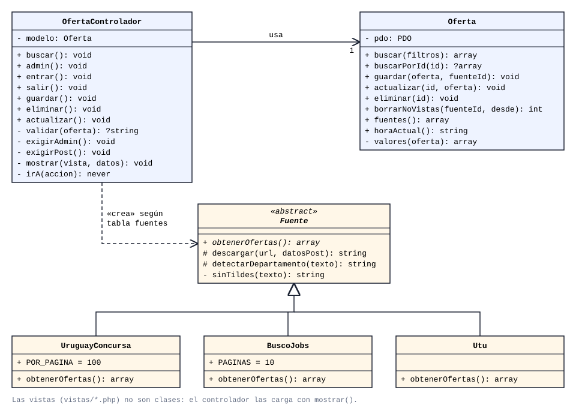

# UTalent — Documentación

**Cuarto Práctico · Programación Full-Stack · 3.° BT Tecnologías de la Información**
Escuela Técnica Rocha · 2026 · Lucas Techera

Propuesta elegida: **Opción 3 — Buscador de oportunidades de trabajo.**

UTalent reúne en un solo lugar las ofertas de empleo de varios portales uruguayos y las
muestra con un formato común. Está pensado para estudiantes y egresados de UTU, por eso
incluye filtros por departamento, por tipo de empleador (público o privado), por salario
visible, por postulación online y por primer empleo o pasantía.

---

## 1. Arquitectura, tecnología y diagrama de clases

### 1.1 Patrón de arquitectura: MVC

El sistema sigue el patrón **Modelo–Vista–Controlador (MVC)**:

| Capa | Archivo | Responsabilidad |
|---|---|---|
| Modelo | `modelos/Oferta.php` | Único lugar con SQL. Busca, agrega, modifica y elimina ofertas. |
| Vista | `vistas/*.php` | HTML que muestra los datos. No consulta la base ni toma decisiones. |
| Controlador | `controladores/OfertaControlador.php` | Recibe el pedido, valida los datos, llama al modelo y elige la vista. |

`index.php` es el único punto de entrada: lee el parámetro `?accion=` y llama al método
correspondiente del controlador.

**Por qué MVC:**

- **Separa responsabilidades.** Si cambia el diseño, se tocan solo las vistas y el CSS. Si
  cambia la base de datos, solo el modelo.
- **Es fácil de mantener y explicar.** Cada archivo tiene una única tarea, así que ante un
  error se sabe dónde buscar.
- **Es el patrón que se trabaja en el curso** y el que usan los frameworks más comunes
  (Laravel, Symfony), así que lo aprendido acá sirve después.

**Patrón complementario: Strategy (para las fuentes).** Cada portal de empleo se lee de
forma distinta: con una API JSON, con datos incrustados en la página, etc. Para que el resto
del sistema no tenga que saber esas diferencias, todas las fuentes heredan de la clase
abstracta `Fuente` y deben implementar el mismo método, `obtenerOfertas()`, que devuelve
las ofertas siempre con el mismo formato.

Gracias a esto, **agregar un portal nuevo es crear un archivo en `Servicios/` y una fila en
la tabla `fuentes`**. El controlador recorre la tabla y crea cada fuente por el nombre de su
clase, sin cambiar ninguna otra línea del proyecto.

No se agregaron más patrones (repositorios, servicios, fábricas, colas) porque para el
tamaño de este proyecto sumarían archivos sin aportar beneficios reales.

### 1.2 Tecnología: PHP y MySQL sin frameworks

Se eligió **PHP y MySQL sin frameworks** (vanilla), ejecutado en **XAMPP**, en lugar de Laravel.

| Criterio | PHP vanilla | Laravel |
|---|---|---|
| Archivos del proyecto | 14 archivos propios | Cientos de archivos antes de escribir código propio |
| Comprensión del código | Cada línea se escribió o se revisó para este proyecto | Gran parte del funcionamiento queda oculto en el framework |
| Instalación | Copiar la carpeta e importar un `.sql` | Composer, dependencias, archivo `.env`, migraciones |
| Necesidades del proyecto | Pocas rutas, dos tablas, un panel | Pensado para aplicaciones mucho más grandes |

La letra pide poder identificar y modificar el código en clase. Con PHP vanilla, todo lo que
hace el sistema está a la vista en archivos cortos y comentados. Laravel aporta
herramientas valiosas (rutas, ORM, migraciones, autenticación), pero para un MVP de este
tamaño agregaría complejidad que no se aprovecharía.

Se usa **PDO** para la base de datos porque viene incluido en PHP y permite consultas
preparadas (protección contra inyección SQL).

### 1.3 Diagrama de clases



- `OfertaControlador` **usa** un objeto `Oferta` (el modelo) para acceder a los datos.
- `OfertaControlador` **crea** las fuentes a partir de la tabla `fuentes` (columna `clase`).
- `UruguayConcursa`, `BuscoJobs` y `Utu` **heredan** de la clase abstracta `Fuente`.
  Heredan dos métodos de apoyo: `descargar()`, que hace pedidos HTTP con cURL, y
  `detectarDepartamento()`, que reconoce el departamento dentro de un texto libre.

### 1.4 Modelo de datos

```
fuentes (id PK, nombre, url, clase UNIQUE)
   │ 1
   │
   │ N
ofertas (id PK, fuente_id FK → fuentes.id, titulo, empresa, departamento,
         tipo ENUM('Público','Privado'), salario, postulacion_online, primer_empleo,
         enlace UNIQUE, fecha, vista_en)
```

- `enlace UNIQUE` evita guardar dos veces la misma oferta: si vuelve a llegar, se
  actualiza en lugar de duplicarse (`INSERT ... ON DUPLICATE KEY UPDATE`).
- `fuente_id` puede ser `NULL`: son las ofertas cargadas a mano desde el panel.
- `vista_en` guarda la última vez que una fuente trajo la oferta. Las que no vuelven a
  aparecer en una actualización ya cerraron y se borran.

---

## 2. Aplicación web (MVP)

Las instrucciones de instalación están en el [README](../README.md).

### 2.1 Funcionalidades

**Buscador público** (`index.php`):
- Búsqueda por puesto o empresa.
- Filtros por departamento, tipo (público o privado), salario visible, postulación online,
  y primer empleo o pasantía.
- Cada oferta enlaza al aviso original en el portal de origen.
- Diseño adaptable a celular, tablet y computadora.

**Panel de administración** (`index.php?accion=admin`, con contraseña):
- **Actualizar ofertas:** consulta todas las fuentes, guarda las nuevas y borra las cerradas.
- **Alta, modificación y baja** de ofertas, por ejemplo una pasantía local que no esté en
  ningún portal.

### 2.2 Fuentes de datos

Antes de leer el HTML de cada portal, se buscó si ofrecía los datos en un formato
estructurado (API o JSON). Así el sistema es más simple y se rompe menos cuando cambia el
diseño de un sitio.

| Fuente | Tipo | Cómo se obtienen los datos |
|---|---|---|
| Uruguay Concursa | Público | API JSON que usa su propia web (`/api-backend/llamados/find`), pidiendo solo los llamados abiertos. |
| UTU (DGETP) | Público | API JSON estándar de WordPress (`/wp-json/wp/v2/posts`). Se filtran los anuncios que empiezan con "Llamado". |
| BuscoJobs | Privado | Cada página del listado trae las ofertas en un bloque JSON (`__NEXT_DATA__`). Se lee ese bloque y no el HTML. |

Fuentes evaluadas y descartadas:

| Fuente | Motivo |
|---|---|
| Computrabajo | Rechaza los pedidos automatizados (error 403). Saltar ese bloqueo haciéndose pasar por un navegador no sería correcto. |
| Gallito Trabajo, Indeed, Jooble | Rechazan los pedidos automatizados (error 403). |
| Vía Trabajo (MTSS) | Para ver las ofertas hay que iniciar sesión. |
| LinkedIn | Sus condiciones de uso prohíben la extracción automatizada. |
| Get on Board | Tiene API pública, pero casi no publica ofertas de Uruguay. |

### 2.3 Decisiones de diseño

- **No se consultan los portales en cada búsqueda.** El administrador actualiza las ofertas,
  que quedan en la base local, y los usuarios buscan sobre esa base. Así las búsquedas son
  instantáneas y no se sobrecargan los portales.
- **Una fuente caída no rompe el sistema.** Cada fuente se procesa dentro de su propio
  `try/catch`. Si una falla, se registra el error, se avisa en el panel y se sigue con las
  demás. Si una fuente vuelve vacía, no se borran sus ofertas, porque puede estar caída.
- **Formato común.** Cada fuente convierte sus datos a las mismas claves (`titulo`,
  `empresa`, `departamento`, etc.), así la base y las vistas no dependen del portal.

### 2.4 Seguridad

| Riesgo | Medida |
|---|---|
| Inyección SQL | Todas las consultas son preparadas con PDO (`?`). |
| XSS (código inyectado en la página) | Todo texto se muestra con `e()`, que usa `htmlspecialchars`. Los enlaces solo se aceptan si empiezan con `http://` o `https://`. |
| CSRF (formularios enviados desde otra web) | Cada formulario lleva un token de sesión que se verifica con `hash_equals`. La cookie de sesión es `SameSite=Lax`. |
| Robo de la cookie de sesión | La cookie se marca `HttpOnly`, así JavaScript no puede leerla. |
| Contraseña del panel | Se guarda como hash (`password_hash` / `password_verify`), nunca en texto plano. Al iniciar sesión se regenera el id de sesión. |
| Datos inválidos en el panel | El controlador valida campos obligatorios, departamento, tipo, largo de los textos y fecha. |

### 2.5 Limitaciones conocidas

- Muchos llamados públicos (sobre todo de UdelaR y ASSE) no indican el departamento en
  ningún campo, y aparecen como "Sin especificar".
- BuscoJobs no publica el salario en el listado, así que el filtro "con salario a la vista"
  solo muestra llamados públicos.
- La lectura de BuscoJobs depende de la estructura interna de su página. Si el portal la
  cambia, hay que ajustar `Servicios/BuscoJobs.php` y el resto del sistema sigue funcionando.
- El panel tiene una sola contraseña compartida, porque la letra no pide registro de usuarios.

---

## 3. Uso de inteligencia artificial

<!-- Revisar esta sección con tus palabras antes de entregar: debe reflejar lo que hiciste vos. -->

### 3.1 Modelo utilizado

Se usó **Claude Opus 5.5** (Anthropic), a través de **Claude Code**, un asistente de
programación que trabaja sobre los archivos del proyecto.

### 3.2 Para qué se usó

| Tarea | Qué hizo la IA | Qué decidió el estudiante |
|---|---|---|
| Análisis de la letra | Resumió las tres opciones y los ejercicios. | Elegir la Opción 3 y el enfoque hacia estudiantes de UTU. |
| Investigación de fuentes | Probó cada portal y encontró las APIs JSON de Uruguay Concursa y UTU y el bloque JSON de BuscoJobs. | Qué portales incluir y descartar los que bloquean el acceso. |
| Arquitectura y tecnología | Propuso MVC con fuentes intercambiables y comparó PHP vanilla con Laravel. | Rehacer el proyecto desde cero con PHP vanilla, priorizando que sea simple y entendible. |
| Programación | Generó el código de todos los archivos y lo probó (búsqueda, panel, seguridad). | Requisitos, nombres de carpetas y cambios de organización. |
| Auditoría | Revisó el código y corrigió errores (por ejemplo, colores del CSS que dejaban el texto invisible). | Pedir la revisión y los criterios: simple, mantenible y comentado. |
| Documentación | Redactó este documento y el diagrama de clases. | Revisión del contenido. |

### 3.3 Cómo identificar y modificar el código

El código está comentado en español y cada archivo tiene una única responsabilidad. Algunos
ejemplos de modificaciones que se pueden hacer en clase:

| Cambio pedido | Dónde y cómo |
|---|---|
| Traer más ofertas de BuscoJobs | `Servicios/BuscoJobs.php` → cambiar `const PAGINAS = 10`. |
| Mostrar más de 200 resultados | `modelos/Oferta.php`, método `buscar()` → cambiar `LIMIT 200`. |
| Ordenar por título en vez de por fecha | `modelos/Oferta.php`, método `buscar()` → `ORDER BY o.titulo`. |
| Agregar un filtro nuevo (por ejemplo, por fuente) | Un `<select name="fuente">` en `vistas/buscar.php` y un `if` más en `Oferta::buscar()`. |
| Agregar un portal nuevo | Crear `Servicios/NuevoPortal.php` que extienda `Fuente` y agregar su fila en la tabla `fuentes`. |
| Cambiar los colores | Variables de `:root` al inicio de `estilos.css`. |
| Cambiar la contraseña del panel | Generar un hash nuevo con `password_hash` y pegarlo en `CLAVE_ADMIN` (`config.php`). |

### 3.4 Qué se aprendió

- Antes de hacer *web scraping* conviene revisar si el sitio ya ofrece los datos
  estructurados. Muchas webs modernas usan internamente una API JSON, que es más fácil y
  más estable de leer.
- Cómo aplicar MVC sin framework: el punto de entrada, la separación entre modelo, vista y
  controlador, y por qué el SQL va solo en el modelo.
- Cómo una clase abstracta permite tratar igual a objetos que funcionan distinto
  (polimorfismo), y cómo eso hace al sistema fácil de ampliar.
- Prácticas básicas de seguridad web: consultas preparadas, escape de HTML, tokens CSRF y
  contraseñas con hash.
- Más simple no es peor: una versión anterior del proyecto, con muchos archivos y capas, era
  más difícil de entender y mantener sin funcionar mejor.
- Hay que revisar lo que genera la IA. Entender el código es necesario para poder
  defenderlo, corregirlo y cambiarlo.

### 3.5 Aporte al proyecto de egreso

- **Arquitectura reutilizable:** la estructura MVC y el punto de entrada único sirven de
  base para organizar el proyecto de egreso.
- **Integración con servicios externos:** consumir APIs, manejar errores de terceros y
  normalizar datos son tareas que aparecen en casi cualquier sistema real.
- **Seguridad desde el inicio:** las medidas del punto 2.4 se pueden aplicar directamente.
- **Trabajo con IA:** se practicó usar la IA como herramienta, revisando y entendiendo lo
  que produce en vez de copiarlo sin entender.
